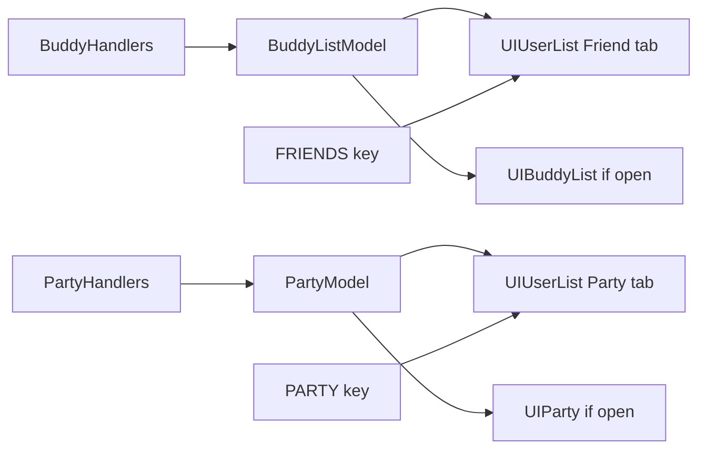

# Angel 全流程审计 · P0 实现计划

## 目标与已确认决策

依据 [docs/features/angel-flow-audit-2026-11/README.md](docs/features/angel-flow-audit-2026-11/README.md) 与用户「直接开始计划」：

- **T0** s9 优先；校准 ≠ 改回原生
- **T1** UserList 好友/组员页灌数据（消双轨空壳）
- **T2** KeyConfig 改挂 `MEDAL(28)`，去掉 `BOSSPARTY(27)` 槽误导
- **T3** Quest 107 不补 x/y·action0（本批零协议改动）
- **T4** 任务指引 blink / Progress 浮层 → **P2 预留，本批不做**
- **T5** NpcTalk 不直发 107（本批只对齐文档口径）
- **T6** 远征自研面板不做
- **T7** 本批 = **仅 P0**
- **T8** 真机冒烟由用户屏前；计划内给验收清单，不假装已测

实现启动时先把本 Plan 落盘为 [docs/features/angel-flow-audit-2026-11/PLAN.md](docs/features/angel-flow-audit-2026-11/PLAN.md)，并回写 README「§Plan / 已确认」。

## 架构（T1 选定路径）

对齐家族页已落地的 `GuildModel` 模式（[Character/GuildModel.h](Character/GuildModel.h)）：handler 写常驻模型，UserList 页签读模型；浮窗仅在已打开时同步，**不再为刷列表强制弹浮窗**。

## 有序任务分解

### P0-0 落盘与基线（文档，闭环）

- 写入 `docs/features/angel-flow-audit-2026-11/PLAN.md`（本文）
- README 标注 T0–T8 已确认、P0 范围、P2 显式预留

### P0-1 KeyConfig 勋章槽（闭环）

**文件**：[IO/UITypes/UIKeyConfig.cpp](IO/UITypes/UIKeyConfig.cpp)、必要时 [IO/KeyAction.h](IO/KeyAction.h) 注释、[Net/KeyMapTranslate.h](Net/KeyMapTranslate.h) 注释对齐

**改法**：

1. classic `kClassicActions[]`（约 365 行）将 `BOSSPARTY` 换成 `MEDAL`
2. modern 未绑定条（约 394–395 行）同替换；保证 `MEDAL` 有槽位坐标
3. `to_server(MEDAL)=27` / `from_server(27)=MEDAL` 已存在，**不改协议映射**
4. [IO/UIStateGame.cpp](IO/UIStateGame.cpp) 保留 `BOSSPARTY→GUILD 页` 分支（旧存档若仍绑 27 经 from_server 已变 MEDAL；裸枚举残留仅兜底），注释写清「KeyConfig 不再提供 BOSSPARTY」

**不做**：改 keymap 存档格式；补远征面板。

### P0-2 BuddyListModel + UserList 好友页（闭环）

**新增**：`Character/BuddyListModel.h` / `.cpp`（仿 GuildModel）

- 把 [IO/UITypes/UIBuddyList.h](IO/UITypes/UIBuddyList.h) 中 `Buddy` / `BuddyListData` 上移到模型头（或模型 include 后 UI 复用）
- API：`get()` / `data()` / `set` / `clear` / 频道增量更新

**改**：

- [Net/Handlers/BuddyHandlers.cpp](Net/Handlers/BuddyHandlers.cpp)：mode 7/0x14 等先写模型；`UIBuddyList` **仅已存在则 update**（取消 mode7 强制 `emplace` 开窗，对齐家族 R28-B2）
- [IO/UITypes/UIBuddyList.cpp](IO/UITypes/UIBuddyList.cpp)：`update_buddies` 同步写模型；打开时从模型重载
- [IO/UITypes/UIUserList.cpp](IO/UITypes/UIUserList.cpp) `draw_friend_tab` / `update`：读模型画成员行（名/组/频道或在线态），更新 `(n/capacity)`；空列表才显示 `userlist.none`
- [IO/UITypes/UIChatBar.cpp](IO/UITypes/UIChatBar.cpp) 好友收件人：优先读 `BuddyListModel`（避免依赖浮窗是否创建过）

**布局**：复用现有 banner/列头/分隔线节点与家族页行高经验；行数受现有 slider 约束，不新发明页签美术。

### P0-3 PartyModel + UserList 组员页（闭环，依赖 P0-2 同模式）

**新增**：`Character/PartyModel.h` / `.cpp`

- 上移 [IO/UITypes/UIParty.h](IO/UITypes/UIParty.h) 的 `Party` / `PartyMember`（或模型持有同构副本）

**改**：

- [Net/Handlers/PartyHandlers.cpp](Net/Handlers/PartyHandlers.cpp)：解析后写 `PartyModel`；`UIParty` 仅已打开时 `update_party`；活动中的 `UIUserList` 刷新组员页
- [IO/UITypes/UIUserList.cpp](IO/UITypes/UIUserList.cpp) `draw_party_tab`：在线/离线分区绘成员，修正硬编码 `0/0`
- 组队相关按钮（Create/Invite/Leave 等）继续走现有 `PartyPackets`，本批不扩 083 九钮

### P0-4 工程接线

- [MapleStory.vcxproj](MapleStory.vcxproj) / [MapleStory.vcxproj.filters](MapleStory.vcxproj.filters) 加入 BuddyListModel / PartyModel

### P0-5 过时文档回写 + 任务框口径（文档闭环）

| 项 | 动作 |
| --- | --- |
| feature-gap **C7 勋章 ❌** | 改为 🟡/`UIMedal` 已落地 + KeyConfig P0 |
| feature-gap **C17 / 287·288 无 handler** | 改为已注册（[Net/PacketSwitch.cpp](Net/PacketSwitch.cpp) 664–665）；pulley 上行仍预留 |
| angel-flow-audit README | 状态改「P0 Plan 已确认待实现 / 实现中」 |
| `notes/r02-npc-script-quest-talk.md` | 固化 T3/T5：107 不补包体；NpcTalk 不直发；blink/Progress = P2 |
| pending-live-tests | 追加本批真机项编号（见验证门禁） |

### 显式不进本批（预留）

- T4 任务指引 blink、`CNoticeQuestProgress`
- Quest 107 x/y、action0；NpcTalk 内嵌发 107
- 远征面板；BossHP 多 oid；图鉴 String 链；勋章 Detail/图标列
- UserList 好友/组员完整 083 钮表深度、拒绝列表灌数据（非 T1 范围）

## REA / IDA / WZ 步骤（只读复核，实现前）

1. **IDA Angel 13339**（`tools/_ida_mcp.py`）：抽查 `CUIUserList` 好友/组员绘行与 `CUIMedalQuestInfo` 仅作对照；不改回原生窗族
2. **不跑** Quest 包体改造；不接 095 符号
3. **WZ**：UserList 好友/组员行若需节点名，优先 orange-wz 128B key → 失败再 `.nx`；本批以现有 `userlist_runtime_nodes` / 家族页行绘为样板，避免大改资源

## 验证门禁

1. 静态：新增模型被 UserList/Handlers 引用；KeyConfig 无 `BOSSPARTY` 槽、有 `MEDAL`
2. 构建：`MSBuild` Release\|x64，0 error
3. `gen_opcode_matrix.py --check`（本批不应改 opcode；确认 GATE OK）
4. **真机验收清单（用户屏前，T8）**：
   - 键位设置：可见「勋章」、不可见误导性 BossParty 槽；分号键 / 绑 MEDAL 开 `UIMedal`
   - F 键仍开学院 `UIFamily`（`MEDALS` 槽行为不变）
   - FRIENDS 键 → UserList 好友页有名单与计数（有好友时非永久 `userlist.none`）
   - PARTY 键 → 组员页有成员；组队变更后页签刷新
   - 好友更新时不强制弹出独立 `UIBuddyList`
   - 回归：G 家族页、图鉴(b)、商城(`) 键位翻译仍正确

## 产物

- `docs/features/angel-flow-audit-2026-11/PLAN.md`
- `notes/` 实现笔记（handler 不再强开浮窗、模型 API）
- `evidence/` 可选：改前空壳截帧说明 / 构建 hash
- README 最终实现逻辑在 P0 闭环后补一小节

## 风险与回滚

| 风险 | 缓解 |
| --- | --- |
| BuddyHandlers 不再强开浮窗，依赖独立窗的旧路径 | UIBuddyList 仍可手动/其它入口打开；Chat 改读模型 |
| Party/Buddy 结构上移导致编译面扩大 | 先搬类型再改 handler，单编译单元推进 |
| KeyConfig 改槽后旧本地未绑定图标错位 | 仅未绑定动作条；已绑定键靠 from_server 语义 |
| 行绘像素与 083 不完全一致 | P0 以「有数据可读」为验收；像素精修挂后续 |

回滚：还原 KeyConfig 两处数组；删除模型文件并恢复 Handlers 强开浮窗；文档 C7/C17 可再标回（不推荐）。

## 实现顺序（确认后 Agent 执行）

1. 落盘 PLAN.md + README 确认态
2. P0-1 KeyConfig
3. P0-2 BuddyListModel + handlers + UserList 好友 + ChatBar
4. P0-3 PartyModel + handlers + UserList 组员
5. P0-4 vcxproj
6. 构建门禁
7. P0-5 文档回写
8. 交付真机清单，等用户测

> **状态（2026-11-12）**：用户已确认 T0–T8；P0 **实现中**。

