# r17 · 全量原生功能面 + 依赖规划（离线可规划产物）

> 日期：2026-10-22  
> 目标原生：`E:\MXD\BeiDou-ClientV17.7\BeiDou.exe`（**非** ijl15 / `自定义功能实现`）  
> 当前端：`E:\project\MapleStory-Client`  
> 服务端：`BeiDou-Server_s9`（172 channel Handler，见 [`evidence/s9_handlers.txt`](evidence/s9_handlers.txt)）  
> **本轮约束：禁止长时间挂 REA/IDA**；仅用仓库既有文档与 `evidence/` 离线汇总。  
> 依据：[`r14-native-feature-catalog.md`](r14-native-feature-catalog.md)、[`r15-baseline-ui-gap-vs-screenshots.md`](r15-baseline-ui-gap-vs-screenshots.md)、[`r16-rea-coverage-gap.md`](r16-rea-coverage-gap.md)、[`../../v83-hud-quest/evidence/UIWindow.img.top-level.txt`](../../v83-hud-quest/evidence/UIWindow.img.top-level.txt)、`IO/UIElement.h`、`Net/PacketSwitch.cpp`、既有 `evidence/r14–r17/`。

---

## 0. 「分析齐」定义（A / B / C）+ 本轮诚实边界

### 0.1 三层证据

| 层 | 含义 | 能做什么 | 不能做什么 | 典型产物 |
| --- | --- | --- | --- | --- |
| **A · 功能面 catalog** | 知道「有这个窗/系统」 | 排优先级、对 s9、列 Wave | **不能**当实现蓝图 | `UIWindow.img` 112 节点；r14 总表 |
| **B · 字符串 / xref 锚点** | 串 EA + 引用 `sub_*` | 定点 `rea decompile` 入口 | ≠ 控件表/包序/点击链 | `ida_xrefs_key_ui.json`；`rea search` |
| **C · decompile + 控件表/包序** | 伪代码可抽出 CreateCtrl / 路径 / 发包序 | **完美对照实现与验收** | — | Maker `sub_822350`；StatusBar CreateCtrl 表 |

```
A ──知道有──▶ B ──找到构造函数──▶ C ──可完美复刻──▶ 实机截图验收
```

**「分析齐」= 目标实现项达到 C，并通过正确客户端截图 + s9 包序验收。**  
不是「55654 函数全反编译」。

### 0.2 本轮实际交付（诚实）

| 声明 | 事实 |
| --- | --- |
| 本轮做了什么 | 用 r14–r16 + UIWindow 112 + s9 + PacketSwitch + 磁盘上已有 `evidence/r17/` **离线**建成**全量功能面 + 依赖/波次规划** |
| 本轮**没有**做什么 | 未调用 REA/IDA MCP；未循环 `rea.cmd`；未假装「全量反编译完成」 |
| 未达 C 的项 | 一律标 **「待 REA 升层」**；有 EA 的进 §5.1，无 EA 的进 §5.2 |
| 磁盘上已有伪代码 | 先前轮次已落盘若干 `evidence/r17/rea_decompile_*.txt`（Maker/Hammer/Vega/…）→ 本表记 **C−**（伪代码有，控件表/行为表未必抽全），**仍待升层到真 C** |

**已达真 C / 近 C（可当样板）：**

| 系统 | 层 | 说明 |
| --- | --- | --- |
| Maker `sub_822350` | **C** | 完整伪代码 + 控件 id（r14） |
| StatusBar CreateCtrl `sub_8D01B2` | **C−** | 坐标表齐；QS 点击/handler 行为未抽全（r15/r16） |
| DrawWorldItems `sub_624E13` 等 | **B→C−** | r17 磁盘有 decompile txt，控件表待抽 |

---

## 1. 主链依赖图（mermaid）

```mermaid
flowchart TB
  subgraph Wave0["Wave0 · 登录→进图 HUD 主链"]
    Login["Login / Title / Loading"]
    World["WorldSelect"]
    Channel["Channel 展开 / GoWorld"]
    CharSelect["CharSelect + charInfo + rank"]
    EnterGame["EnterGame / Fade / SetField"]
    StatusBar["StatusBar · 底栏 + QS 点击"]
    Login --> World --> Channel --> CharSelect --> EnterGame --> StatusBar
  end

  subgraph Core["Wave1 · CoreWindows 深度"]
    SEIK["Stat / Equip / Item / Skill"]
    Quest["Quest + QuestAlarm"]
    NPC["UtilDlgEx 分支 / Shop"]
    SkillMacro["SkillMacro / SkillEx / Enchant"]
    KeyTip["KeyConfig / ToolTip"]
    StatusBar --> SEIK
    StatusBar --> Quest
    StatusBar --> NPC
    SEIK --> SkillMacro
    SEIK --> KeyTip
  end

  subgraph Social["SocialEco · 已接线精修"]
    UserList["UserList 页签"]
    Trunk["Trunk / Storage"]
    TradeMerch["Trade / Merchant 变体"]
    Maker["Maker C 样板"]
    Alliance["Alliance"]
    Book["MonsterBook"]
    StatusBar --> UserList
    StatusBar --> Trunk
    StatusBar --> TradeMerch
    UserList --> Alliance
  end

  subgraph WaveA["Wave2 · Wave A 原生缺口（依赖排序）"]
    Messenger["1 Messenger"]
    PartySearch["2 PartySearch"]
    Delivery["3 Delivery / Duey"]
    StoreBank["4 StoreBank / Fredrick"]
    Hammer["5 ViciousHammer"]
    Vega["6 VegaSpell"]
    Gacha["7 CashGachapon / RemoteGachapon"]
    Family["8 Family / FamilyTree"]
    MemoFame["9 Memo + Fame 入口"]
    Energy["10 EnergyBar / TemporaryStat"]
    StatusBar --> Messenger
    UserList --> PartySearch
    UserList --> Family
    NPC --> Delivery
    NPC --> StoreBank
    SEIK --> Hammer
    SEIK --> Vega
    SEIK --> Gacha
    SEIK --> MemoFame
    SEIK --> Energy
  end

  subgraph WaveB["Wave3 · Activities"]
    Mini["Minigame / RPS"]
    MC["MonsterCarnival"]
    Wedding["Wedding"]
    Race["PartyRace / DualMobGauge"]
    MiscAct["TreasureBox / raise / plant / NewYears…"]
    StatusBar --> Mini
    StatusBar --> MC
    StatusBar --> Wedding
    StatusBar --> Race
    StatusBar --> MiscAct
  end
```



**读图要点：** Wave0 不通 → 后续 Wave 无法实机验收；Wave2 依赖 StatusBar + Core/Social 入口；Wave3 不阻塞主链。

---

## 2. 推荐实现波次（防遗漏 / 防依赖炸）

### Wave0 · 用户报障 + r15 基础 UI（先于一切内容窗）

| 序 | 项 | 根因（r15） | 是否必须先达 C？ | 建议 |
| --- | --- | --- | --- | --- |
| 0.1 | 登录背景 / 书本框 / 木牌 | 对照未闭环 / 坐标 | 建议升 C，但可叠图先修 | `LoginBackground` step0 + `UILogin` |
| 0.2 | Loading 卷轴 | 对照 / bar 偏移 | 建议升 C | `UILoginWait` |
| 0.3 | 频道过滤 + 可选 | **硬缺陷** `channel_count < 2` | **否**（实现缺陷明确） | 改为 `< 1`；再叠图升 C |
| 0.4 | 选角 charInfo + 排行 | 坐标 + 未绘 rank | 建议升 C | 补「排行不可用」+ 原点校准 |
| 0.5 | 底栏四钮 + **快捷格点击** | 未接线 / DBG | 坐标已有 C−；行为待升 C | QS hit→keymap 分发 |

> **用户要求「先分析再实现」：** Wave0 **实现前**建议先对 Login / Channel(World) / CharSelect / StatusBar **升到 C**（或至少 C− 控件表齐）。  
> **但：** 功能清单、依赖与波次顺序 **本文件已可规划**；升 C 与实现可按「一批证据 → 一批小改」交错，不必等 5 万函数。

### Wave1 · Core 深度对齐

1. QuestAlarm 接线（Quest 已有 B/`sub_83EA05`，磁盘有 r17 decompile → 抽控件）  
2. UtilDlgEx_Avatar / Pet / MultiPetEquip 分支  
3. SkillMacro / SkillMacroEx / SkillEx / EnchantSkill / SkillUp  
4. ToolTip 族深度（`sub_8E49B5`）  
5. UserList 页签 vs Party/Buddy/Guild 精修（`sub_917546`）  
6. EnergyBar / TemporaryStatView  
7. CashShop 礼物/礼包等简化项（独立 img）

### Wave2 · Wave A 原生缺口（按依赖排序）

与 r14 §6 一致，略调依赖：

1. **Messenger**（社交入口，s9 `MessengerHandler`）  
2. **PartySearch**（`sub_49D0B6`，依赖 UserList/组队）  
3. **Delivery / Duey**（NPC/经济，叶串有、构造 EA 待 xref）  
4. **StoreBank / Fredrick**（仍缺 EA，s9 `FredrickHandler`/`RemoteStore`）  
5. **ViciousHammer**（`sub_82A9BC`，磁盘已有伪代码 → 抽控件 + `UseHammer`）  
6. **VegaSpell**（`sub_82BB83`）  
7. **CashGachapon / RemoteGachapon**（前者有 EA；后者缺串）  
8. **Family / FamilyTree**（缺 EA；s9 Family* 齐）  
9. **Memo + Fame 入口**（`NoteAction` / `GiveFame`）  
10. **Skill 宏 / Energy** 若 Wave1 未完则并入收尾  

并行可后置但属经济变体：**CashTradingRoom / EntrustedShop / MemberShop 店主视图 / ITC·MTS**。

### Wave3 · Activities

Minigame/RPS → MonsterCarnival → Wedding → PartyRace/DualMobGauge → TreasureBox/raise/plant/NewYearsCard → MapleTV/Admin*（P4）。

---

## 3. 完整功能总表

### 图例

| 列 | 含义 |
| --- | --- |
| 证据层 | A / B / B+ / C− / C（据 r14–r16 + 磁盘 r17 伪代码有无） |
| 当前端 | ✅ 已有 · 🟡 部分 · ❌ 缺失 · ➖ 非独立功能（控件/装饰） |
| s9 | ✅ 有 Handler · 🟡 间接/部分 · ❌ 无独立 · — 纯 UI |
| 依赖 | 实现前需可用的上游 |
| 被依赖 | 下游谁需要本项 |
| 风险 | 高=主链/验收炸 · 中=内容闭环 · 低=后置/控件 |
| 波次 | W0 / W1 / W2 / W3 / 控件 / 后置 |

**PacketSwitch 现状（约 76 emplace）：** 登录选角、进图、移动攻击、NPC/店、背包、Buff/技能、任务、仓库、组队/好友/交易/公会/联盟、雇佣商人、图鉴、商城壳、`LIMIT_BREAK_SYNC`。  
**尚未在客户端注册、但 s9 已有的典型：** Messenger / Family* / Duey / PartySearch* / UseHammer / Note / Fredrick / RemoteGachapon / Wedding* / RPS / MonsterCarnival / NewYearCard / MTS 等 → 实现期逐包补 `emplace`。

---

### 3.1 主链扩展（非 UIWindow 顶层，但必须进规划）

| 节点 | 证据层 | 当前端 | s9 | 依赖 | 被依赖 | 风险 | 波次 | 备注 / 待升层 |
| --- | --- | --- | --- | --- | --- | --- | --- | --- |
| Login / Title / signboard | A | 🟡 | ✅ Login* | — | WorldSelect | 高 | W0 | **待 REA 升层** Title OnCreate |
| LoginNotice / TOS | A | 🟡/✅ | ✅ AcceptToS 等 | Login | — | 中 | W0 | 弹窗叠图 |
| LoginWait / Loading | A | 🟡 | — | Login | WorldSelect | 高 | W0 | **待 REA 升层** Loading 控件 |
| WorldSelect / DrawWorldItems | B+→C− | 🟡 | ✅ Serverlist/ChangeChannel | Login | CharSelect | 高 | W0 | `channel_count<2` 先修；`0x624E13` 伪代码已有→抽牌表 |
| Channel 展开 / GoWorld | A/B | 🟡 | ✅ | WorldSelect | CharSelect | 高 | W0 | **待 REA 升层** 展开卷 |
| CharSelect + charInfo + rank | A | 🟡 | ✅ Charlist/Select | World | EnterGame | 高 | W0 | **待 REA 升层** 构造 EA；rank 未绘 |
| EnterGame / SetField / Fade | A | 🟡 | ✅ ChangeMap/PlayerLoggedin | CharSelect | StatusBar | 高 | W0 | 与 StatusBar 合并验收 |
| StatusBar.img 底栏 | C− | 🟡 | — | EnterGame | 几乎全部游戏窗 | 高 | W0 | CreateCtrl 齐；**QS/handler 待升 C** |
| CashShop（独立 img） | A | 🟡 | ✅ CashOperation/EnterCashShop | StatusBar | Gacha 等 | 中 | W1/W2 | 礼物/礼包简化 |
| ITC/MTS（ITC.img） | A | ❌ | ✅ MTSHandler/EnterMTS | StatusBar | — | 中 | W2 后置 | 非 UIWindow 节点 |

---

### 3.2 UIWindow.img 全部 112 节点

> 顺序与 [`UIWindow.img.top-level.txt`](../../v83-hud-quest/evidence/UIWindow.img.top-level.txt) 一致（112/112）。

| # | 节点 | 证据层 | 当前端 | s9 | 依赖 | 被依赖 | 风险 | 波次 | 备注 / 待升层 |
| --- | ---: | --- | --- | --- | --- | --- | --- | --- | --- |
| 1 | BtUIClose | A | ➖/🟡 | — | 各窗 | — | 低 | 控件 | 通用关窗 |
| 2 | BtUIClose2 | A | ➖/🟡 | — | 各窗 | — | 低 | 控件 | 同上 |
| 3 | Item | A | ✅ ITEMINVENTORY | ✅ Inventory* | StatusBar | Trade/Shop/Maker… | 高 | W0/W1 | 深度布局 r05；**待升层**仅当偏差 |
| 4 | Equip | A | ✅ EQUIPINVENTORY | ✅ | StatusBar | Hammer/Scroll | 高 | W0/W1 | 同左 |
| 5 | Stat | A | ✅ STATSINFO | ✅ DistributeAP 等 | StatusBar | CharInfo | 高 | W0/W1 | 同左 |
| 6 | Skill | A | 🟡 SKILLBOOK | ✅ Skill* | StatusBar | Macro/Enchant | 高 | W1 | SkillEx 等未齐 |
| 7 | ToolTip | B→C− | 🟡 | — | Item/Equip | 全局悬停 | 中 | W1 | `sub_8E49B5` 伪代码有→**待抽 tip 表升 C** |
| 8 | Shop | A | ✅ SHOP | ✅ NPCShop | NPC | — | 高 | 已有 | 精修按需 |
| 9 | Messenger | A | ❌ | ✅ MessengerHandler | StatusBar/UserList | — | 中 | **W2-1** | **待 REA 升层**（无构造 EA） |
| 10 | UtilDlgEx | A | 🟡 NPCTALK | ✅ NPCTalk/MoreTalk | EnterGame | Shop/Quest | 高 | W1 | 多分支不全 |
| 11 | UtilDlgEx_Avatar | A | 🟡 | ✅ | UtilDlgEx | — | 中 | W1 | 头像分支 |
| 12 | UtilDlgEx_Pet | A | 🟡 | ✅ | UtilDlgEx | — | 中 | W1 | 宠物对话 |
| 13 | GameOpt | A | ✅ OPTIONMENU | — | StatusBar | — | 低 | 已有 | |
| 14 | SysOpt | A | ✅ OPTIONMENU | — | StatusBar | — | 低 | 已有 | 常与 GameOpt 同窗 |
| 15 | ContextMenu | A | 🟡 | — | StatusBar | ShortCut | 中 | W1 | 右键菜单 |
| 16 | FloatNotice | A | ✅ STATUSMESSENGER 等 | ✅ ServerMessage | — | — | 低 | 已有 | |
| 17 | UserInfo | A | ✅ CHARINFO | ✅ CharInfoRequest | StatusBar | Fame/Memo | 中 | W1/W2 | Fame 入口缺 |
| 18 | WorldMap | A | ✅ WORLDMAP | 🟡 WorldMapPlayers | StatusBar | — | 中 | 已有 | Tip 扩展属 ijl15，排除 |
| 19 | TradingRoom | A | 🟡 TRADE | ✅ PlayerInteraction | StatusBar | CashTradingRoom | 中 | W1/W2 | 现金房未分 |
| 20 | PersonalShop | A | 🟡 MERCHANT | ✅ PlayerInteraction | StatusBar | — | 中 | W1/W2 | 访客为主 |
| 21 | Channel | A | ✅ CHANNEL | ✅ ChangeChannel | StatusBar | — | 中 | 已有 | 进图后换频 |
| 22 | Quest | B→C− | 🟡 QUESTLOG | ✅ QuestAction | StatusBar | QuestAlarm | 高 | W1 | `sub_83EA05` 伪代码有→**待升 C** |
| 23 | QuestAlarm | A | ❌ | ✅ QuestAction | Quest | — | 中 | **W1** | 未接线；**待 REA 升层** |
| 24 | ItemMove | A | 🟡 | ✅ ItemMove | Item | — | 低 | W1 | 整理动画/提示 |
| 25 | Coupon | A | ❌ | ✅ CouponCodeHandler | CashShop | — | 低 | W2 后置 | |
| 26 | Minigame | A | ❌ | ✅ RPSAction | StatusBar | MinigameTable | 低 | **W3** | **待 REA 升层** |
| 27 | MultiLine | A | ➖/🟡 | — | Notice | — | 低 | 控件 | 多行文本 |
| 28 | RpsGame | A | ❌ | ✅ RPSAction | Minigame | — | 低 | **W3** | |
| 29 | Trunk | A | ✅ STORAGE | ✅ StorageHandler | NPC/StatusBar | — | 中 | 已有 | 布局精修按需 |
| 30 | MinigameTable | A | ❌ | ✅ RPSAction | Minigame | — | 低 | **W3** | |
| 31 | KeyConfig | A | ✅/🟡 KEYCONFIG | ✅ KeymapChange | StatusBar | QS 点击 | 高 | W0/W1 | classic 默认键位 |
| 32 | MiniMap | A | ✅ MINIMAP | — | EnterGame | — | 中 | 已有 | |
| 33 | GameMenu | A | 🟡 STATUSBAR | — | StatusBar | — | 中 | W0/W1 | BtMenu |
| 34 | ShortCut | A | 🟡 | — | StatusBar | QS | 高 | **W0** | 与快捷格相关 |
| 35 | SoftKeyboard | A | ✅ SOFTKEYBOARD | — | Login/Chat | — | 低 | 已有 | |
| 36 | FadeYesNo | A | 🟡 | — | EnterGame | — | 中 | W0 | 过场 |
| 37 | Memo | A | ❌ | ✅ NoteActionHandler | UserInfo | — | 中 | **W2-9** | **待 REA 升层** |
| 38 | Notice | A | ✅ NOTICE | ✅ ServerMessage | — | FloatNotice | 低 | 已有 | |
| 39 | IconBase | A | ➖ | — | 多窗 | — | 低 | 控件 | |
| 40 | Megaphone | A | ❌ | 🟡 UseCashItem/Chat | Chat | — | 低 | W2 后置 | |
| 41 | Teleport | A | 🟡 | 🟡 Trock 等 | — | — | 低 | 控件/技能 | |
| 42 | Reset | A | ➖ | — | — | — | 低 | 控件 | |
| 43 | BetaEdition | A | ➖ | — | — | — | 低 | 废弃 | |
| 44 | Report | A | ❌ | ✅ ReportHandler | — | — | 低 | 后置 P4 | 串多为 CNM 误报 |
| 45 | Admin | A | ❌ | ✅ Admin* | — | GMBoard | 低 | 后置 P4 | |
| 46 | Macro | A | 🟡 | ✅ SkillMacro | Skill | SkillMacro | 中 | W1 | 与 SkillMacro 族 |
| 47 | QuestIcon | A | 🟡 | — | Quest | — | 低 | W1 | 地图任务标 |
| 48 | MobGage | A | ❌ | — | 战斗 | DualMobGauge | 低 | W3 | |
| 49 | UserList | B→C− | 🟡 USERLIST+Party/Buddy/Guild | ✅ Party/Buddy/Guild | StatusBar | PartySearch/Alliance/Family | 高 | W1 | `sub_917546` 伪代码有→**待升 C** |
| 50 | EntrustedShop | A | 🟡 MERCHANT | ✅ HiredMerchant | PersonalShop | — | 中 | W2 经济 | 店主视图不全 |
| 51 | Claim | A | ❌ | ✅ Report 等 | — | AdminClaim | 低 | 后置 P4 | |
| 52 | ItemProtector | A | ❌ | 🟡 UseCashItem | Item | — | 低 | W2 后置 | |
| 53 | Book | A | ❌ | — | — | — | 低 | W2 后置 | ≠ MonsterBook |
| 54 | StoreBank | A | ❌ | ✅ Fredrick/RemoteStore | NPC | — | 中 | **W2-4** | **待 REA 升层**（无串） |
| 55 | MemberShop | A | 🟡 | ✅ PlayerInteraction | PersonalShop | — | 中 | W2 经济 | |
| 56 | Incubator | A | ❌ | 🟡 Use* | Item | — | 低 | W2 后置 | |
| 57 | TemporaryStatView | A | 🟡 BUFFLIST | — | StatusBar | — | 中 | W1 | |
| 58 | itemSearch | A | ❌ | 🟡 Owl 等 | — | — | 低 | W2 后置 | |
| 59 | Wedding | A | ❌ | ✅ Wedding* | StatusBar | — | 低 | **W3** | 仅 `wedding%d` 串 |
| 60 | Delivery | B− | ❌ | ✅ DueyHandler | NPC | — | 中 | **W2-3** | 叶串有、**构造 EA 待 xref** |
| 61 | MapleTV | A | ❌ | — | — | — | 低 | 后置 | |
| 62 | EnchantSkill | A | ❌/🟡 | ✅ Skill* | Skill | — | 中 | **W1** | **待 REA 升层** |
| 63 | AvatarMegaphone | A | ❌ | 🟡 UseCashItem | Megaphone | — | 低 | W2 后置 | |
| 64 | MonsterCarnival | A | ❌ | ✅ MonsterCarnivalHandler | StatusBar | — | 低 | **W3** | **待 REA 升层** |
| 65 | plant | A | ❌ | ✅ Raise* | — | raise | 低 | **W3** | |
| 66 | ExceptionItemSearch | A | ❌ | — | itemSearch | — | 低 | 后置 | |
| 67 | MateMessage | A | ❌ | — | — | — | 低 | 后置 | |
| 68 | InitialQuiz | A | ❌ | — | — | SpeedQuiz | 低 | **W3** | |
| 69 | UtilDlgEx_MultiPetEquip | A | 🟡 | ✅ | UtilDlgEx | — | 中 | W1 | |
| 70 | CancelRequests | A | ❌ | — | Social | — | 低 | 后置 | |
| 71 | ItemMegaphone | A | ❌ | 🟡 UseCashItem | Megaphone | — | 低 | W2 后置 | |
| 72 | SpeedQuiz | A | ❌ | — | InitialQuiz | — | 低 | **W3** | |
| 73 | EnergyBar | A | 🟡 | — | Skill/Buff | — | 中 | W1/W2-10 | |
| 74 | SkillMacro | A | 🟡 | ✅ SkillMacroHandler | Skill | MacroSkill | 中 | **W1** | PacketSwitch 已有 `SKILL_MACROS` |
| 75 | raise | A | ❌ | ✅ Raise* | plant | — | 低 | **W3** | |
| 76 | MonsterBook | A | ✅ MONSTERBOOK | ✅ MonsterBookCover | StatusBar | — | 中 | 已有 | 简化展示 |
| 77 | EventWindow | A | ✅ EVENT | — | StatusBar | — | 低 | 已有 | |
| 78 | PartySearch | B→C− | ❌ | ✅ PartySearch* | UserList/Party | — | 中 | **W2-2** | `sub_49D0B6` 伪代码有→**待升 C** |
| 79 | AriantMatch | A | ❌ | — | — | classMatch | 低 | **W3** | |
| 80 | TreasureBox | A | ❌ | ✅ UseTreasureChest | — | — | 低 | **W3** | |
| 81 | NewYearsCard | A | ❌ | ✅ NewYearCardHandler | — | — | 低 | **W3** | |
| 82 | Transform | A | ❌ | 效果/技能 | — | — | 低 | 后置 | |
| 83 | ArtMegaphone | A | ❌ | 🟡 UseCashItem | Megaphone | — | 低 | W2 后置 | |
| 84 | Maker | **C** | ✅ MAKER | ✅ MakerSkillHandler | Skill/Item | — | 低 | 已有 | **样板**；可选精修 |
| 85 | muruengRaid | A | ❌ | 脚本/活动 | — | — | 低 | **W3** | |
| 86 | classMatch | A | ❌ | — | AriantMatch | — | 低 | **W3** | |
| 87 | AdminClaim | A | ❌ | ✅ Admin*/Report | Claim | — | 低 | 后置 P4 | |
| 88 | MacroSkill | A | 🟡 | ✅ SkillMacro | SkillMacro | — | 中 | W1 | |
| 89 | Ranking | A | ❌ | ❌ 无独立 Rank Handler | CharSelect | — | 中 | 后置/预留 | 选角排行文案可先本地 |
| 90 | Family | A | ❌ | ✅ Family*/OpenFamily* | UserList | FamilyTree | 中 | **W2-8** | **待 REA 升层** |
| 91 | FamilyTree | A | ❌ | ✅ OpenFamilyPedigree | Family | — | 中 | **W2-8** | **待 REA 升层** |
| 92 | KarmaScissors | A | ❌ | 🟡 UseCashItem | Item | — | 低 | W2 后置 | |
| 93 | createCygnus | A | ❌ | 创建/脚本 | CharCreate | — | 低 | 后置 | |
| 94 | RemoteGachapon | A | ❌ | ✅ RemoteGachaponHandler | 地图 NPC | — | 中 | **W2-7** | **待 REA 升层**（0 命中） |
| 95 | CharacterClone | A | ❌ | — | — | — | 低 | 后置 | |
| 96 | ViciousHammer | B→C− | ❌ | ✅ UseHammerHandler | Equip/Item | — | 中 | **W2-5** | `sub_82A9BC` 伪代码有→**待升 C** |
| 97 | CashGachapon | B→C− | ❌ | 🟡 Cash*/Surprise | CashShop | — | 中 | **W2-7** | `sub_999E4D` 伪代码有→**待升 C** |
| 98 | counsel | A | ❌ | — | — | — | 低 | 后置 P4 | |
| 99 | GMBoard | A | ❌ | ✅ Admin* | Admin | — | 低 | 后置 P4 | |
| 100 | Radio | A | ❌ | — | — | — | 低 | 后置 | |
| 101 | Title | A | ➖/🟡 | — | Login | — | 低 | W0/控件 | Login.img Title 相关 |
| 102 | CashTradingRoom | A | ❌/🟡 | ✅ PlayerInteraction | TradingRoom | — | 中 | W2 经济 | |
| 103 | AranSkillGuide | A/B | ❌ | — | Skill | — | 低 | W2 后置 | 叶串 `AranSkillGuide/%d` |
| 104 | MonsterKilling | A | ❌ | 活动 | — | — | 低 | **W3** | |
| 105 | MapleEvent | A | ❌ | 活动 | EventWindow | — | 低 | **W3** | |
| 106 | SkillUp | A | ❌/🟡 | ✅ DistributeSP | Skill | — | 中 | W1 | |
| 107 | VegaSpell | B→C− | ❌ | 🟡 Scroll/Use | Equip | — | 中 | **W2-6** | `sub_82BB83` 伪代码有→**待升 C** |
| 108 | PartyRace | B→C− | ❌ | — | StatusBar | — | 低 | **W3** | `sub_56BD3C` 伪代码有 |
| 109 | DualMobGauge | B→C− | ❌ | — | MobGage | — | 低 | **W3** | `sub_56C9B7` 伪代码有 |
| 110 | SlideMenu | A | 🟡 STATUSBAR | — | StatusBar | — | 中 | W0/W1 | |
| 111 | SkillMacroEx | A | ❌/🟡 | ✅ SkillMacro | SkillMacro | — | 中 | **W1** | **待 REA 升层** |
| 112 | SkillEx | A | ❌/🟡 | ✅ Skill* | Skill | — | 中 | **W1** | **待 REA 升层** |

**覆盖核对：UIWindow 顶层 112/112 均已入表；另加 §3.1 主链 10 行（Login→StatusBar + CashShop + ITC）。**

---

### 3.3 Alliance（能力行，非独立 UIWindow 顶层名）

| 能力 | 证据层 | 当前端 | s9 | 依赖 | 被依赖 | 风险 | 波次 |
| --- | --- | --- | --- | --- | --- | --- | --- |
| Guild Alliance UI/操作 | B→C− | ✅ ALLIANCE | ✅ AllianceOperation/Deny | UserList/Guild | — | 中 | W1 精修 | `goAlliance*` → `sub_49D0B6` |

---

## 4. 依赖关系摘要（实现防炸）

| 若先做… | 会炸/验收不了的原因 | 正确前置 |
| --- | --- | --- |
| Wave A Messenger… | 进不了图或底栏不可点 → 无法开窗联调 | Wave0 StatusBar/QS |
| PartySearch | 无组队/UserList 页签上下文 | Wave1 UserList 精修或至少 Party ✅ |
| Hammer/Vega | 无 Equip/Item 拖放链路 | Wave0 SEIK 可开 |
| Duey/StoreBank | 无 NPC 对话进窗 | UtilDlgEx/NPC ✅ |
| Family | 无社交列表入口 | UserList |
| Activities | 不阻塞主链，但依赖 StatusBar 挂载 | Wave0 完成后随时可插 |

**客户端 Packet 债（实现 Wave2/3 时必补 emplace，对照 s9）：**  
Messenger、Family*、Duey、PartySearch*、UseHammer、NoteAction、Fredrick/RemoteStore、RemoteGachapon、Wedding*、RPS、MonsterCarnival、NewYearCard、MTS、Coupon、Report…（以 `OutPacket.h` / s9 Opcode 为准，禁止臆造）。

---

## 5. 剩余 REA 升层清单（本轮不跑；IDA 稳定后执行）

### 5.1 已有 EA → 可立刻 decompile / 抽控件表（优先）

> 磁盘上部分已有 `evidence/r17/rea_decompile_*.txt`；下一步是**抽 CreateCtrl/路径/包序落盘控件表**，升到真 **C**。禁止 `rea analyze` 整包。

| 优先级 | 系统 | EA | 现状 | 升层动作 |
| --- | --- | --- | --- | --- |
| P0 | StatusBar 行为 | `0x8D01B2` | C− 坐标 | 抽 button handler / QS hit / 聊天绑定 |
| P0 | DrawWorldItems | `0x624E13` | C− 伪代码 | 抽竖牌间距/原点/过滤条件对照 |
| P1 | Quest | `0x83EA05` | C− | 控件表 + QuestAlarm 关联 |
| P1 | UserList | `0x917546` | C− | 页签 CreateCtrl |
| P1 | ToolTip | `0x8E49B5` | C− | tip 族分支表 |
| P1 | PartySearch/Alliance 脚本 | `0x49D0B6` | C− | BtStart 等 + go* 分发 |
| P1 | ViciousHammer | `0x82A9BC` | C− | 控件 + UseHammer 序 |
| P1 | VegaSpell | `0x82BB83` | C− | 同上 |
| P1 | CashGachapon | `0x999E4D` | C− | 同上 |
| P3 | PartyRace | `0x56BD3C` | C− | 活动 HUD |
| P3 | DualMobGauge | `0x56C9B7` | C− | 双怪条 |
| 样板 | Maker | `0x822350` | **C** | 可选精修 |

**Wave0 实现前建议优先升 C 的四条主链：**

1. Login Title / Loading（先 search 短串 `signboard` / `Loading/backgrnd` → 再 decompile）  
2. World/Channel（`0x624E13` + 展开卷构造）  
3. CharSelect（search `charInfo` / 槽位叶 → 构造 EA → decompile）  
4. StatusBar 行为（在 `0x8D01B2` 上补全）

### 5.2 仍缺构造 EA（等 IDA 稳定后再 search/xref）

| 系统 | 既有线索 | 建议搜法 |
| --- | --- | --- |
| Messenger | CNM* 误报；UI 路径 0 | 叶控件名、`Messenger/` ascii/UTF16 |
| Family / FamilyTree | 0 命中 | 资源叶 + s9 `OpenFamily*` 发包入口反推 |
| StoreBank | 0 命中 | Fredrick NPC / `RemoteStore` |
| Memo | 误报多 | 便签叶名 / Note 包 |
| RemoteGachapon | 0 命中 | Handler 名交叉、地图脚本 |
| Delivery 构造 | 叶串 `Delivery/*` @ `0xafcc7c`… | **xref → 构造**（r16 已标） |
| CharSelect / Login Title | 完整路径常 0 | 短关键字 + Obj 叶 |
| SkillEx / SkillMacroEx / EnchantSkill | 多 0 | 叶名分批 search |
| Minigame / Wedding / MC 多数 | A | 后置；开放时再挖 |
| Ranking | 无 s9 Handler | 可只做 UI 预留 |

### 5.3 轻量复现命令（供 IDA 稳定后；本轮不执行）

```powershell
$env:REA_ANALYSIS_PROVIDER = 'ida'
$env:REA_IDA_MCP_CONFIG   = 'C:\Users\11036\.rea\ida-mcp.json'
$exe = 'E:\MXD\BeiDou-ClientV17.7\BeiDou.exe'

# 已有 EA：decompile（以 observations/code 为准；可能 schema 报错）
& 'D:\software\nodejs-24\rea.cmd' decompile $exe 0x8D01B2 --provider ida --json
& 'D:\software\nodejs-24\rea.cmd' decompile $exe 0x624E13 --provider ida --json

# 缺 EA：短关键字 search → xref（禁止 rea analyze 整包）
& 'D:\software\nodejs-24\rea.cmd' search $exe 'signboard' --kind strings --provider ida --json
& 'D:\software\nodejs-24\rea.cmd' search $exe 'Delivery' --kind strings --provider ida --json
```

证据建议落盘：`notes/evidence/r17/batch-<Name>/`（本轮规划文档不代替控件表）。

---

## 6. 与既有文档关系

| 文档 | 角色 |
| --- | --- |
| r14 | A 层功能面 + Wave A–D 初稿 + 少量 B 锚点 |
| r15 | 截图差距；证明主因是实现/对照，不是「没反完 5 万函数」 |
| r16 | 哪些批次未达 C |
| **本文件 r17** | **112 全表 + 主链 + 依赖图 + 可执行波次 + REA 升层待办**（离线可规划） |
| `evidence/r17/*` | 先前轮次 search/decompile 落盘；**不等于**本轮已分析齐 |

---

## 7. 边界（再次强调）

- 只服务 **exe 原生**完整复刻；`ijl15` / `自定义功能实现` 不在表内实现范围。  
- 端侧 ✅ ≠ REA 已达 C。  
- 未达 C 标 **待 REA 升层**；有规划不等于已反编译完。  
- 验收：正确客户端截图 + s9 字段序 + 主链回归。

---

## 8. Parent / 决策摘要

| 问题 | 答案 |
| --- | --- |
| 112 是否全进表？ | **是（112/112）**，另含 Login/World/Char/StatusBar/CashShop/ITC 主链行 |
| 推荐波次 | **W0** 登录·频道·选角·底栏QS → **W1** Core 深度 → **W2** Messenger…Wave A → **W3** Activities |
| 文档路径 | `docs/features/beidou-v17-parity/notes/r17-full-native-analysis-and-dependency-plan.md` |
| C 层缺口 | 主链 Login/Channel/CharSelect/StatusBar**行为**仍未真 C；Wave A 多数 C− 或 A；**仅 Maker 为真 C 样板** |
| 先分析再实现 | W0 实现前建议先对四条主链升 C；**清单与顺序已可规划，不必等全量反编译** |
