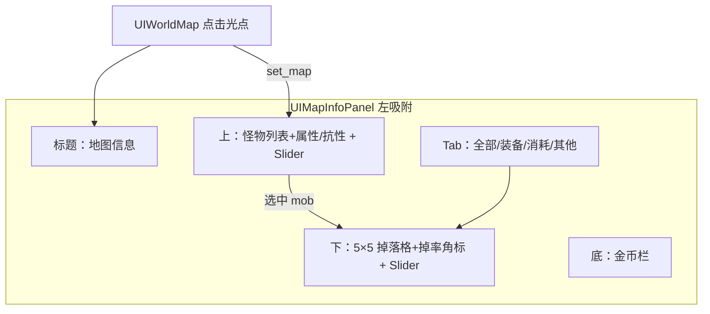

# 地图信息侧栏（左）— 设计稿

> 状态：**决策已锁定**（D1–D7）+ 2026-09-30 反馈修订（标题 Y、背包格、5×5、上区增高、掉率角标、金币区间口径）  
> 适用客户端：MapleStory-Client（Journey 系）  
> 产物目录：`docs/features/map-info-panel/`  
> 日期：2026-09-30  
> 视觉参照：`map-mob-drops`（Border 银蓝 chrome）+ `map-search-ui`（背包式 Tab / LocalPngTexture）

---

## 0. 现状 Constraints（只读结论）

| 模块 | 关键常量 / 行为 | 对本设计的含义 |
| --- | --- | --- |
| `UIMapMobPanel` | **宽 168**、高随 Border（默认 537）；`ROW_HEIGHT=48`、`VISIBLE_ROWS=6` | **保留**（D2 并存）；新栏是独立左栏功能，不替换 |
| `UIMapDropPanel` | **宽 210**、右贴；无分类 Tab | **保留**；新栏下半区自带掉落格，不依赖右栏 |
| `UIMapSearchPanel` | **宽 260**、高 537；Tab=`LocalTwoSpriteButton` | chrome / Tab 同款银蓝 + 二态 |
| `UIWorldMap` 吸附 | 左：`pos - MobWIDTH`；右：Border + search_rail + MapSearch + Drop | 并存时左侧可能叠两个左栏或择一显示 — 实现期定吸附策略 |
| `get_mobs_on_map` | `MapMobInfo{id,name,level,max_hp}` | 需扩展 `exp` / `boss`；属性/抗性字段实现期再扩或 WZ 预留 |
| `MobDropData` | stub → 空；`MobDropEntry{item_id,chance,min_qty,max_qty}` | 有真表则接；掉率用 `chance`；数量区间用 min/max |
| `UIItemInventory` | `disabled` 图标尺寸默认 **32×32**；槽步进 `icon + slot_space`(space=4) | **掉落格边长 = 32**，对齐背包图标格 |
| `InventoryType::by_item_id` | EQUIP / USE / SETUP / ETC / CASH… | Tab「其他」= 非装备非消耗（含 CASH） |

当前世界地图横向排布（并存目标态示意）：

```
[地图信息 240] | [怪物栏 168?] | [世界地图 Border] | [原 Search] | [地图搜索 260] | [掉落栏 210]
```

> 并存下左侧是否同时显示「地图信息」与「怪物栏」由实现期吸附策略决定；本设计要求**不删除**旧两侧栏代码与资源。

---

## 1. 目标 / 非目标

### 目标

打开世界地图并点击地图光点后，左侧吸附「地图信息」面板（银蓝 Border chrome）：

1. **上半区（加高）**：该图怪物列表；**右侧滚动条**；约 **3 行可见**（行更高）；行内：图标 | 名称、等级、类型（普通/BOSS）、HP、EXP，以及 **属性 / 抗性**（本版 UI 占位，真数据实现期接 WZ）。  
2. **下半区**：**5×5** 背包式掉落格（格边 **32×32** = 背包）；Tab：全部 / 装备 / 消耗 / 其他；默认 `item_id` 升序；**右侧滚动条**；格内 **掉率角标**（仿数量叠字，绑 `chance`，真数据后接）。  
3. **底栏**：类似背包的**金币栏**（白框 + 标签；金额运行时绘制）。

### 非目标（本阶段）

- 不强制本 pass 完整 C++ 接线（assets + docs 优先）。  
- 不删除 / 不停用 `UIMapMobPanel` / `UIMapDropPanel`。  
- 不改 map-search 1B 吸附与逻辑。  
- 不做传送 / 搜索过滤。

---

## 2. 已锁定决策（D1–D7）

| ID | 决策 | 说明 |
| --- | --- | --- |
| **D1** | 宽 **240**，高 **537**（贴 WorldMap Border） | 介于旧 mob(168) 与 search(260) |
| **D2** | **并存** | 保留 `UIMapMobPanel` / `UIMapDropPanel`；本功能独立 |
| **D3** | `boss`→**BOSS**，否则**普通** | 精英接口预留，本版不标精英 |
| **D4** | ① 底栏 **金币栏**（背包 meso 白框风格）② Tab「其他」= 非装备/非消耗（**含 CASH** + SETUP + ETC 等） | 金币栏与「其他」分类是两件事，一并锁定 |
| **D5** | 标题「地图信息」+ Tab 文案烤进 PNG | 与 map-search 一致；动态空态可用英文/后续 i18n |
| **D6** | **有真数据则接**；掉落 UI 为**背包格子**（非纯列表行） | stub 时空态；装载后填格 |
| **D7** | **现在出图**；上、下区均有右侧滚动条轨道 | 本 pass 生成 chrome / Tab / preview / layout |

---

## 3. 布局（240×537）

### 3.1 ASCII

```
┌─────────── 地图信息 240×537 ───────────┐
│ ╔════ title chrome band ONLY ════╗     │  ← 标题仅在 Border 顶带上半脊居中
│ ║         地 图 信 息             ║     │     禁止落入白井（well @ top_h+4）
│ ╚════════════════════════════════╝     │
│ ┌─ 上：怪物列表/详情 well（加高）─┐ ▌  │
│ │ [ico] 蓝蜗牛  Lv.1  普通       │ ▌  │  ← ~3 可见行 ROW≈78
│ │       HP 15   EXP 3            │ ▌  │     + 属性/抗性占位行
│ │       属性: …  抗性: …         │ ▌  │     右 Slider 轨道
│ │ …                              │ ▌  │
│ └────────────────────────────────┘    │
│ [全部][装备][消耗][其他]               │  ← TwoSprite Tab（字烤进 PNG）
│ ┌─ 下：掉落 5×5 背包格 well ────┐ ▌  │
│ │ [口][口][口][口][口]           │ ▌  │  ← 32×32×5×5 + 右滚动条
│ │ [口]…  角标「45%」式掉率       │ ▌  │     溢出仍靠 Slider 滚行
│ └────────────────────────────────┘    │
│ ┌─ meso 白框 ─────────┐ mesos         │  ← 背包金币栏风格；数字运行时画
└───────────────────────────────────────┘
```

### 3.2 分区高度粗算

| 区 | 建议 | 备注 |
| --- | --- | --- |
| 标题 chrome | Border `top_h`≈33 | `draw_title` 墨水钳在上脊 `[3, top_h-12]`，光学上抬，远离白井 |
| 上列表 well | **~230+**（优先吃剩余高度） | `VISIBLE_ROWS=3`，`ROW_H≈78`；含属性/抗性行 |
| Tab 行 | 18 | enabled/disabled 二态；四等分内容宽 |
| 下格子 well | **≈174**（刚好 5×5） | `cols=5` `rows=5` `slot=32` `gap=2`；右 scroll |
| 底 meso 栏 | ~18–22 | 白框 + 「mesos」标签位 |

精确像素见 `resources/layout.json`（由 `_gen_map_info_ui.py` 导出）。

### 3.3 Mermaid



---

## 4. 上半区：怪物行（加高）

| 字段 | 来源 | 展示 |
| --- | --- | --- |
| 图标 | `Mob/{id}.img` stand 首帧 ~40px | 左 `ICON_BOX≈40` |
| 名称 | `MapMobInfo.name` | 主行，过长截断 |
| 等级 | `level` | `Lv.N` |
| 类型 | D3：`info/boss`→BOSS else 普通 | 可着色 |
| HP | `max_hp` | `HP {n}` |
| EXP | `Mob.img/info/exp`（实现期扩 `MapMobInfo`） | `EXP {n}` |
| 属性 | WZ / 表预留（本版 **占位**） | `属性: …` |
| 抗性 | WZ / 表预留（本版 **占位**） | `抗性: …` |

- 行高 **~78**；可见 **3**；`Slider::DEFAULT_SILVER`。  
- 排序：level 升序，同级 id 升序。  
- 空态：「该地图没有怪物」（实现期编码策略另定）。  
- 上区高度优先：下区只保留 5×5 + Tab + meso 所需最小高度，剩余给上区。

---

## 5. 下半区：掉落格子 + Tab

### 5.1 Tab

- `LocalTwoSpriteButton`：`Tab/enabled|disabled/{all,equip,consume,etc}.png`  
- 顺序：全部 | 装备 | 消耗 | 其他；默认全部。  
- 切换仅过滤，不改 `MobDropData` 缓存。

### 5.2 分类（D4）

| Tab | `InventoryType` |
| --- | --- |
| 全部 | 不过滤 |
| 装备 | `EQUIP` |
| 消耗 | `USE` |
| 其他 | `SETUP` + `ETC` + `CASH` + 其余非 EQUIP/USE |

### 5.3 格子尺寸 vs 背包（已测量）

| 来源 | 结论 |
| --- | --- |
| `UIItemInventory.cpp` | `disabled.get_dimensions()`，缺省 **`icon_width/height = 32`** |
| 槽步进 | `icon_width + slot_space_x`（v83 无 pos 时 `slot_space=4` → 步进 36） |
| **本面板格子** | **边长 32×32**（与背包图标格一致）；格间距 2（侧栏更紧，不等于背包步进 36） |

### 5.4 网格（D6 + 反馈）

- **可见 5 列 × 5 行**；溢出靠右侧 Slider 按行滚动。  
- 视觉：白/浅槽 + `#8899BB` 描边；图标居中。  
- 排序：默认 `item_id` 升序。  
- 悬停（实现期）：`UI::show_item(Tooltip::Parent::WORLDMAP, item_id)`。

### 5.5 掉率角标（反馈）

- 展示位置：格内 **右下角**，仿背包数量叠字。  
- 文案：由 `MobDropEntry.chance`（[0,1]）格式化为百分比如 `45%` / `0.1%`。  
- **本 pass**：chrome **不烤**掉率；preview 仅示意；实现期绑真数据。  
- stub / 无效表：不画角标或画空态。

空态：未选怪 / stub 无效 / 分类过滤空 — 文案实现期定。

---

## 6. 底栏金币（D4）+ 掉落金币区间口径

### 6.1 UI

- 样式仿 `UIItemInventory` meso 白框：凹陷白条 + 右侧「mesos」类标签位（标签可烤进底板）。  
- **数字不烤进底图**；运行时 `Text` 右对齐写入。  
- 底栏金额默认：角色 `inventory.get_meso()`（实现期）；亦可后续改为「选中怪金币掉落展示」。

### 6.2 「金币掉落是区间值吗？」— 本客户端事实

| 证据 | 内容 |
| --- | --- |
| `Data/MobDropData.h` | `MobDropEntry` 仅有 `item_id` / `chance` / **`min_qty` / `max_qty`**；**无** `meso_min` / `meso_max` 专用字段 |
| `Data/MobDropData.cpp` | stub：`valid=false`，`entries` 空，**无任何金币掉落真数据** |
| `docs/features/map-mob-drops/notes/drop-json-schema.md` | 预留 JSON 同样只有道具 `min_qty`~`max_qty`，**未单独定义 meso 区间字段** |

**结论（写入设计口径）**：典型私服掉落表里金币常为 min~max 区间；**本客户端目前没有已装载的金币区间真值**。结构上 `min_qty`~`max_qty` 具备区间能力（若将来约定 `item_id=0` 表示 meso，或另加 `meso_min/max`），但 **现状 = stub / 未知**，不得编造区间。接入真表时再在 schema 明确 meso 是专用字段还是 `item_id=0` + qty 区间。

---

## 7. 与旧栏关系（D2）

- **不**移除 `UIMapMobPanel` / `UIMapDropPanel` 源码与 chrome。  
- 新面板建议路径：`UI/MapInfo/` + `UIMapInfoPanel`。  
- 吸附：实现期在 `UIWorldMap` 增加左栏位置计算；若与旧左栏冲突，优先可配置开关或互斥显示 — **须另抉择时再问用户**，默认文档记「并存保留代码」。

---

## 8. 资源清单

### 8.1 chrome/

| 文件 | 尺寸 | 说明 |
| --- | --- | --- |
| `info_panel_backgrnd.png` | **240×537** | Border；标题烤「地图信息」；上列表井（加高）+ 下 5×5 井 + meso；双 scroll track |
| `list_row_selected.png` | 内容宽×行高 | 怪物行选中底 |
| `slot.png` | **32×32** | 掉落背包格（对齐 inventory icon） |

### 8.2 Tab/

- `Tab/enabled/{all,equip,consume,etc}.png`  
- `Tab/disabled/{all,equip,consume,etc}.png`  

### 8.3 路径

| 用途 | 路径 |
| --- | --- |
| 开发源 | `docs/features/map-info-panel/resources/` |
| 仓库运行时 | `UI/MapInfo/` |
| 客户端同步 | `E:\MXD\BeiDou-Client-xy\UI\MapInfo\`（父目录存在则复制） |

生成脚本：`resources/_gen_map_info_ui.py`（Border 切片同 `map-mob-drops/.../UIWindow_WorldMap/`；`draw_title` 顶脊钳位 + 光学上抬）。

预览：`resources/preview/info_panel_alone.png`、`preview/dock_context.png`。

---

## 9. 数据口径

- 怪物：`get_mobs_on_map` + exp / boss 扩展；属性/抗性本版 UI 占位。  
- 掉落：`MobDropData::get_drops`；有文件/表则装载，否则空态。  
- 掉率角标：`chance` → 百分文案。  
- 类型：仅 `boss` 布尔。  
- Tab 过滤：`InventoryType::by_item_id`。  
- 金币掉落区间：见 §6.2（stub，无真区间）。

---

## 10. 验收标准（实现后）

1. 点世界地图光点 → 左侧「地图信息」出现，240×537；标题在顶 chrome，不进白井。  
2. 上区显著高于下区；约 3 行可滚；含名/Lv/类型/HP/EXP + 属性/抗性占位。  
3. 下区可见 **5×5**、格 **32×32**；点怪刷新；Tab 过滤；id 升序；掉率角标有数据时显示。  
4. 底栏金币白框；金额运行时正确。  
5. 旧 mob/drop 面板代码仍在；本功能可独立开关或并存。  
6. 关世界地图面板同步消失。

---

## 11. 修订记录

| 日期 | 说明 |
| --- | --- |
| 2026-09-29 | 初稿：设计-only，待 D1–D7 |
| 2026-09-30 | 锁定 D1–D7；改为背包格掉落 + 底 meso 栏；并存；出图 |
| 2026-09-30 | 反馈：标题顶脊上抬；格=背包 32；5×5；上区加高+属性/抗性占位；掉率角标；金币区间 stub 口径 |
